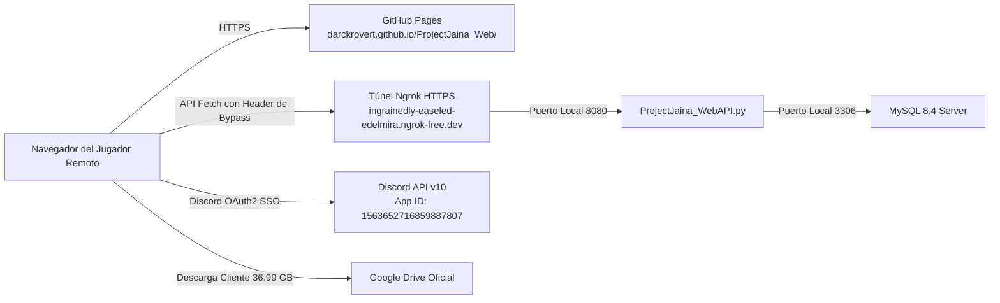

# GOBERNANZA TÉCNICA DEL PORTAL WEB PÚBLICO (PROJECTJAINA_WEB)

**Módulo:** `E:\ProjectJaina_Web`  
**Proyecto:** Project JAIna (Portal Web Oficial AAA & Living Lore)  
**Estándar:** Staff Software Engineer L9 (Mythos 5)  
**Fecha de Actualización:** 24 de Octubre de 2026  
**Líder & Arquitecto General:** DarckRovert (Elnazzareno)  
**Staff AI Engineer:** Antigravity L9 (Mythos 5)  

---

## 1. Misión, Soberanía y Alcance del Módulo

`E:\ProjectJaina_Web` aloja el código fuente del portal web público oficial de Project JAIna. Su propósito es brindar una experiencia AAA inmersiva (Glassmorphism arcano, estética Theramore), telemetría en tiempo real del reino, armería de personajes con soporte de diacríticos UTF-8, base de datos AoWoW, catálogo de tienda comunitaria, diálogo interactivo con Lady Jaina Proudmoore, registro seguro de cuentas de jugadores mediante SRP6, autenticación Discord OAuth2 SSO 1-clic y distribución directa del cliente oficial.

El portal es soberano y de código abierto bajo licencia MIT, enlazado directamente al clúster de simulación local mediante túneles seguros.

---

## 2. Topología de Despliegue y Conectividad Híbrida

El portal opera bajo un modelo desacoplado Serverless Frontend + Self-Hosted Backend:



### Tabla de Endpoints y Parámetros Técnicos

| Componente | URL Canónica / Destino | Protocolo / Puerto | Función |
| :--- | :--- | :--- | :--- |
| **Frontend Web** | `https://darckrovert.github.io/ProjectJaina_Web/` | HTTPS (GitHub Pages) | Interfaz visual, páginas HTML/CSS/JS. |
| **Túnel REST API** | `https://ingrainedly-easeled-edelmira.ngrok-free.dev` | HTTPS (Ngrok L7) | Traspaso seguro de consultas y registros. |
| **Backend REST Local** | `http://127.0.0.1:8080` | HTTP (Python WebAPI) | Endpoints `/api/register`, `/api/status`, `/api/armory`, etc. |
| **Comunidad & Soporte** | `https://discord.gg/cXxMuRJrfy` | HTTPS (Discord CDN) | Invitación permanente universal del reino. |
| **Condiciones del Servicio** | `https://darckrovert.github.io/ProjectJaina_Web/terms.html` | HTTPS (GitHub Pages) | Marco legal y normas comunitarias. |
| **Política de Privacidad** | `https://darckrovert.github.io/ProjectJaina_Web/privacy.html` | HTTPS (GitHub Pages) | Gobernanza de datos SRP6 y cero cesión a terceros. |
| **Descarga de Cliente** | [Google Drive Oficial](https://drive.google.com/file/d/1VlsfI9WvZ6kyaz03pwC3peJ_hSA3-2MZ/view?usp=drive_link) | HTTPS (Google Cloud) | Distribución de los 36.99 GB del cliente limpio. |

---

## 3. Normativa de Red y Cabeceras Mandatorias (Ngrok Bypass)

Debido a que el túnel de Ngrok opera en el plan gratuito con endpoint estático permanente, la pasarela de Ngrok intercala una pantalla de advertencia intermedia (`ngrok-skip-browser-warning`) si se realizan peticiones `GET` o `POST` desde scripts sin la cabecera adecuada.

### Regla Inmutable de Fetch:
Todo llamado `fetch()` en los módulos de Javascript (`js/register.js`, `js/app.js`, `js/armory.js`, `js/store.js`, `js/jaina_dialogue.js`, `js/countdown.js`, `js/auth.js`) **debe incluir obligatoriamente**:
```javascript
headers: {
    'Content-Type': 'application/json',
    'ngrok-skip-browser-warning': 'true'
}
```
Omitir esta cabecera provocará errores `JSON.parse` inesperados al recibir HTML de intercepción en lugar del JSON de la API.

---

## 4. Gobernanza del Sistema de Registro SRP6 y Discord SSO

1. **Cero Passwords en Texto Plano:**
   - La WebAPI jamás almacena contraseñas en texto plano.
   - Aplica el algoritmo SRP6 (Secure Remote Password 6) nativo de World of Warcraft 3.3.5a utilizando SHA-1, un salt criptográfico aleatorio de 32 bytes y el generador `g = 7` módulo `N` de Blizzard.
2. **Discord OAuth2 Single Sign-On:**
   - Client ID: `1563652716859887807`.
   - Redirecciones autorizadas registradas:
     * `https://darckrovert.github.io/ProjectJaina_Web/`
     * `https://darckrovert.github.io/ProjectJaina_Web/index.html`
3. **Sanitización de Nombres de Usuario:**
   - Longitud: 3 a 16 caracteres alfanuméricos.
   - Normalización: Conversión estricta a mayúsculas (`UPPER(username)`) antes de inserción en `acore_auth.account`.

---

## 5. Gobernanza Legal y Verificación de Aplicación

Para satisfacer los requisitos de verificación de desarrollador de Discord y proteger la soberanía del proyecto:
1. `terms.html` y `privacy.html` deben mantenerse sincronizadas con el repositorio y desplegadas en GitHub Pages.
2. Queda estrictamente prohibida la inserción de enlaces temporales de Discord (ej. `769jdzAYP`). Se auditará que toda referencia web apunte a `https://discord.gg/cXxMuRJrfy`.

---

## 6. Control de Versiones y Despliegue Continuo (CI/CD)

1. **Rama Principal:** `main` en `https://github.com/DarckRovert/ProjectJaina_Web`.
2. **Políticas de Commit:**
   - Todos los cambios deben probarse primero localmente o verificar la validez sintáctica de HTML/JS/CSS.
   - Queda estrictamente prohibido commitear credenciales administrativas de MySQL o tokens privados de sesión.
   - Los enlaces a la API deben provenir de `js/config.js` (`PUBLIC_TUNNEL_API`).

