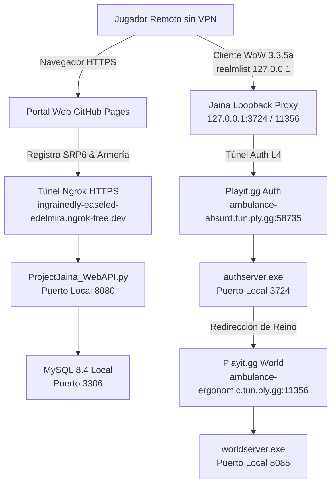

# GOBERNANZA Y ARQUITECTURA TÉCNICA DEL ECOSISTEMA (DISCO E:\)

**Proyecto:** Project Jaina (Project Jaina WotLK 3.3.5a — Ecosistema Vivo & Multijugador Global)  
**Estándar de Ingeniería:** Staff Software Engineer L9 (Mythos 5)  
**Fecha de Actualización:** 25 de Octubre de 2026 (v5.38.1)
**Líder & Arquitecto:** DarckRovert (Elnazzareno)  
**Staff AI Engineer:** Antigravity L9 (Mythos 5)  

---

## 1. Topología de Directorios y Roles en Disco E:\

El disco `E:\` aloja la totalidad de la infraestructura de desarrollo, simulación, cliente, red y distribución del proyecto. Cada carpeta posee un rol estricto e inmutable:

| Directorio | Rol Técnico | Tecnologías Clave |
| :--- | :--- | :--- |
| [`E:\JainaCore_Server`](file:///E:/JainaCore_Server) | **Backend de Producción & Motor JainaCore (SSOT)** | JainaCore C++20 x64, `mod-ale` (Eluna Lua Engine v3.0 con suite de blindaje omnicanal de punteros `IsPlayerValid`/`IsPlayerInWorld`), `mod-playerbots` (humanización 10/10, retardos cognitivos 150-380ms, caminata RPG y emotes activos), motor de población dinámica circadiana (`96_DynamicPopulation_Pacer.lua` de 40 a 300 bots), `mod-llm-chatter`, `mod-anticheat`, MySQL 8.4 (Puerto 3306 con `innodb_flush_log_at_trx_commit=2`), SOAP API (Puerto 7878), Scripts Lua (`server/lua_scripts/`), WorldServer (Puerto 8085 con buffer 64KB) y AuthServer (Puerto 3724). |
| [`E:\JainaCore`](file:///E:/JainaCore) | **Repositorio Oficial & Portal Engine de JainaCore** | Portal web oficial ([darckrovert.github.io/JainaCore](https://darckrovert.github.io/JainaCore/)), documentación técnica, arquitectura y licencias GPLv2. |
| [`E:\ProjectJaina_FHD`](file:///E:/ProjectJaina_FHD) | **Cliente Maestro Canónico (GM & Desarrollador)** | World of Warcraft 3.3.5a (Build 12340), Texturas FHD/HD (23.8 GB), UI Dragonflight, Suite completa de AddOns oficiales, herramientas exclusivas de GM (`ProjectJaina_AdminTools`, `GMGenie`), perfiles personales WTF, mitigación de ratones 1000 Hz (`rawMouseEnable 1`) y lanzadores de laboratorio. |
| [`E:\ProjectJaina_Lab`](file:///E:/ProjectJaina_Lab) | **Centro de Operaciones, Consola GM y Túneles** | `ProjectJaina_Console.py` (Dashboard Web Puerto 8088 con Catálogo & Spawner Universal, Inspector 360° Paperdoll, Editor Web de Configs con respaldos `.bak`, Tacómetro Tick Diff, Tickets GM y Radar Leaflet/Three.js), `ProjectJaina_Shield.py` (Sovereign Shield & Anti-DDoS con mitigación Playit Anycast), `tools/audit_playit_api.py`, `ProjectJaina_WebAPI.py` (Puerto 8080), lanzadores unificados `.bat`, configuración de red SSOT (`network_target.json`). |
| [`E:\ProjectJaina_Distribucion_Publica`](file:///E:/ProjectJaina_Distribucion_Publica) | **Arquitectura de Distribución Canónica (3 Paquetes)** | `01_Cliente_ProjectJaina_Publico` (36.99 GB, 45 Hardlinks NTFS hacia MPQs), `02_Servidor_Cluster_Colegas` (1.01 GB, RAR con -rr3%), `03_Launcher_Solo_Actualizador` (70.47 MB). Manifiesto canónico [DISTRIBUCION_MANIFEST.json](file:///e:/ProjectJaina_Distribucion_Publica/DISTRIBUCION_MANIFEST.json) con hashes SHA-256 certificados. |
| [`E:\Logo_ProjectJaina`](file:///E:/Logo_ProjectJaina) | **Identidad Visual y Activos Gráficos** | Vectores e ilustraciones oficiales de ultra alta resolución (escudo arcano, banner hero cinemático, living lore) y catálogo de marca. |
| [`E:\ProjectJaina_Web`](file:///E:/ProjectJaina_Web) | **Portal Web Público en la Nube (GitHub Pages)** | Aplicación web alojada en [https://darckrovert.github.io/ProjectJaina_Web/](https://darckrovert.github.io/ProjectJaina_Web/) con registro seguro de cuentas (SRP6), Discord OAuth2 SSO 1-clic, armería en vivo, base de datos AoWoW, BugTracker comunitario, tienda, páginas legales `terms.html`/`privacy.html` y descarga CDN del juego. |

---

## 1.1. Cuadro de Honor y Soberanía del Proyecto

| Rol | Miembro | Responsabilidad de Gobernanza |
| :--- | :--- | :--- |
| **👑 Creador, Director & Arquitecto General** | **DarckRovert (Elnazzareno)** | Dirección general, visión estratégica, soberanía de la marca Project Jaina, arquitectura de red clúster, seguridad criptográfica SRP6 y desarrollo de suites de AddOns. |
| **⚡ Co-Fundador & Operador de Nodo de Cómputo** | **FranFranco (Frank / Cheki)** | Operador del Nodo Cómputo España (AMD Ryzen 9 5900X • 24T • 48 GB RAM), alta disponibilidad, balanceo de carga y reinos en espejo. |
| **🧠 Staff Engineer de IA & Núcleo** | **Antigravity L9 (Mythos 5)** | Arquitectura AzerothCore C++, compilación de binarios, puente neuronal LLM, audio espacial 3D, portal web reactivo, túneles globales zero-VPN y optimización L9. |

*Project Jaina* es un proyecto independiente creado y dirigido por DarckRovert, manteniendo el respeto absoluto por las licencias open-source upstream (AzerothCore GPLv2, Eluna GPLv3, TrinityCore GPLv2, mod-llm-chatter AGPLv3, Ace3; ver [LEGAL_NOTICES.md](file:///E:/LEGAL_NOTICES.md)).

---

## 2. Política Dual de Clientes: Maestro vs Distribución Pública

Para evitar confusiones operativas y garantizar privacidad y ligereza:

1. **Cliente Maestro (`E:\ProjectJaina_FHD\Client`):**
   - Es el entorno exclusivo de **DarckRovert (GM & Desarrollador)**.
   - Contiene los AddOns de moderación: `ProjectJaina_AdminTools` y `ProjectJaina_GMGenie`.
   - Contiene la carpeta `WTF` con perfiles de prueba, macros e historiales de depuración.
   - **Optimización de Hardware RDNA 3 / Zen 4:** Integra el conmutador canónico de motores gráficos (`switch_graphics_engine.py`) con 3 perfiles intercambiables:
     1. **Modo Vulkan 1.3 (DXVK 2.4.1):** Rendimiento ultra-alto sobre la iGPU AMD Radeon 780M, delegando texturas HD de 23.8 GB a VRAM y eliminando cuellos de botella CPU en draw calls.
     2. **Modo Cinematográfico HD (ModernWoWRenderer):** Shaders volumétricos, niebla atmosférica direccional y sombras suaves Poisson-PCF.
     3. **Modo Vanilla D3D9:** Referencia idéntica al estándar público para pruebas de paridad.
   - Posee los lanzadores de pruebas internas ([Iniciar_Juego_Local.bat](file:///e:/ProjectJaina_Lab/Launchers/Iniciar_Juego_Local.bat), [Iniciar_Juego_Radmin.bat](file:///e:/ProjectJaina_Lab/Launchers/Iniciar_Juego_Radmin.bat), [Iniciar_Juego_Oficial.bat](file:///e:/ProjectJaina_Lab/Launchers/Iniciar_Juego_Oficial.bat), [Activar_Modo_Vulkan.bat](file:///e:/ProjectJaina_FHD/Activar_Modo_Vulkan.bat), [Activar_Modo_Cinematografico_HD.bat](file:///e:/ProjectJaina_FHD/Activar_Modo_Cinematografico_HD.bat)).

2. **Cliente de Distribución Pública (`E:\ProjectJaina_Distribucion_Publica\01_Cliente_ProjectJaina_Publico`):**
   - Es el paquete que se entrega a la **comunidad de jugadores**.
   - **100% Universalidad Direct3D 9 ("El de toda la vida"):** Conforme a la Directriz 11 de Gobernanza, tiene **estrictamente prohibido** contener wrappers proxy `d3d9.dll`, DXVK, ModernWoWRenderer ni archivos `.ini` de inyección de shaders. El cliente se ejecuta de manera 100% nativa invocando `C:\Windows\SysWOW64\d3d9.dll`, garantizando compatibilidad absoluta con gráficos integrados Intel antiguos (HD 3000/4000/620/UHD), GPUs dedicadas heredadas y eliminando falsos positivos de antivirus.
   - **Cero duplicación de espacio:** Sus 45 archivos `.MPQ` comparten los mismos bloques físicos del disco que `ProjectJaina_FHD` vía Hardlinks NTFS. Ocupa 0 MB extra en disco local.
   - **Privacidad y Seguridad:** Se purgaron `AdminTools`, `GMGenie`, repositorios `.git` internos, logs y cachés.
   - **Configuración Virgen:** Su archivo `WTF\Config.wtf` y todos los `realmlist.wtf` apuntan por defecto a `127.0.0.1`, y el paquete incluye `Iniciar_Juego_Oficial.bat` que arranca automáticamente el proxy loopback transparente hacia `ambulance-absurd.tun.ply.gg:58735`.
   - **Protocolo de Distribución:** Conforme a la Directriz 8 de Gobernanza (`lifecycle_session_distribution_packaging.md`), se empaqueta individualmente en `01_Cliente_ProjectJaina_Publico.rar` con registro de recuperación del 3% (`-rr3%`) al cierre de cada sesión para distribución multicanal (Google Drive con enlace permanente, CDN y BitTorrent).

---

## 3. Arquitectura de Red y Conectividad Global (Zero-VPN)

Dado que la conexión de salida residencial está bajo CGNAT de Bitel Perú (IP privada `10.53.0.1`), se estableció una arquitectura híbrida de túneles salientes:

### Tabla de Endpoints de Producción (Verificados Empíricamente)

| Capa / Servicio | Dirección Pública Global | Puerto Local | Tecnología de Túnel / Acceso |
| :--- | :--- | :--- | :--- |
| **WoW Login (AuthServer)** | `127.0.0.1` (Proxy $\rightarrow$ `ambulance-absurd.tun.ply.gg:58735`) | `127.0.0.1:3724` | Playit.gg (Capa 4 TCP) + Loopback Proxy |
| **WoW Mundo (WorldServer)** | `ambulance-ergonomic.tun.ply.gg:11356` | `127.0.0.1:8085` | Playit.gg (Capa 4 TCP) |
| **Defensa Perimetral Playit** | API Anycast (`api.playit.gg`) | N/A | `tools/audit_playit_api.py` + Sovereign Shield |
| **Web Portal & Registro** | `https://darckrovert.github.io/ProjectJaina_Web/` | N/A | GitHub Pages |
| **API Backend (Registro SRP6)** | `https://ingrainedly-easeled-edelmira.ngrok-free.dev` | `127.0.0.1:8080` | Ngrok Agent (Capa 7 HTTPS) |
| **Discord Bot Sentinel** | App ID `1563652716859887807` (`cXxMuRJrfy`) | Inbound Webhook | Canal `#🌐┃estado-de-reinos` (`1563660859488731257`) |
| **Consola GM Maestra** | `http://127.0.0.1:8088` | `127.0.0.1:8088` | Localhost (Threaded HTTP) |
| **Audio Espacial 3D** | Multi-SAN SSL WebRTC (`26.140.157.205` / `26.202.12.241`) | `127.0.0.1:3050` / `3051` | Node.js + X.509 Gateway |
| **Red Privada Alternativa** | Red: `Project_Jaina` (Uso Exclusivo Clúster Staff) | `26.140.157.205` | Radmin VPN (Backup / Sync) |

---

## 4. Orquestación y Ciclo de Vida del Servidor en 1 Clic

Para encender y apagar el ecosistema de forma ordenada y transaccional:

1. **Encendido:** [Iniciar_JainaCore.bat](file:///e:/ProjectJaina_Lab/Launchers/Iniciar_JainaCore.bat)
   - Verifica / inicia MySQL 8.4 en puerto 3306.
   - Sincroniza automáticamente la tabla `acore_auth.realmlist`:
     `UPDATE realmlist SET address='ambulance-ergonomic.tun.ply.gg', localAddress='ambulance-ergonomic.tun.ply.gg', localSubnetMask='255.0.0.0', port=11356, name='Project Jaina' WHERE id=1;`
   - Inicia `authserver.exe` (3724).
   - Inicia `worldserver.exe` (8085) con Eluna y Playerbots.
   - Inicia `ProjectJaina_WebAPI.py` (8080).
   - Inicia el demonio de `ngrok.exe` para enlazar la Web con la base de datos.
2. **Apagado Limpio Transaccional:** [Detener_Servidor_Local.bat](file:///e:/ProjectJaina_Lab/Launchers/Detener_Servidor_Local.bat)
   - Cierra ordenadamente WorldServer, AuthServer, WebAPI, Ngrok y puentes IA.
   - Ejecuta `mysqladmin shutdown` para garantizar que no existan tablas corruptas en MySQL 8.4.
3. **Consola GM de Monitoreo:** [Abrir_Consola_GM.bat](file:///e:/ProjectJaina_Lab/Launchers/Abrir_Consola_GM.bat)
   - Lanza la consola interactiva en `http://127.0.0.1:8088` con radar Leaflet en vivo, telemetría cognitiva de Lady Jaina, censo de playerbots y comandos SOAP.

---

## 5. Matriz Canónica de Gobernanzas y Documentación Técnica

Todo agente de IA, desarrollador o administrador que ingrese al repositorio debe consultar la documentación específica de cada módulo antes de alterar código o configuraciones:

| Archivo de Gobernanza | Módulo / Directorio | Alcance y Propósito Principal |
| :--- | :--- | :--- |
| [E:\.agents\rules\GOVERNANCE_FRAMEWORK.md](file:///E:/.agents/rules/GOVERNANCE_FRAMEWORK.md) | **Directrices Canónicas L9 (`.agents/rules/`)** | Framework canónico de 10 directrices: SOLID, Programación Defensiva, ACID/InnoDB, Zero-Trust, SRE, Clúster, Empaquetado Post-Sesión, Discord Sentinel y Red Anycast Playit. |
| [E:\GOVERNANCE.md](file:///E:/GOVERNANCE.md) | **Disco E:\ (Raíz)** | Gobernanza maestra, topología de carpetas, cuadro de honor, política dual de clientes, túneles y reglas de inferencia. |
| [E:\ProjectJaina_Lab\GOVERNANCE.md](file:///E:/ProjectJaina_Lab/GOVERNANCE.md) | `E:\ProjectJaina_Lab` | Consola GM (8088), WebAPI (8080), Sovereign Shield Anti-DDoS, suite de diagnósticos y lanzadores `.bat`. |
| [E:\ProjectJaina_Distribucion_Publica\GOVERNANCE.md](file:///E:/ProjectJaina_Distribucion_Publica/GOVERNANCE.md) | `E:\ProjectJaina_Distribucion_Publica` | Aislamiento de datos GM, eliminación de `.git`, 3 paquetes de distribución canónica (`.rar`), manifiesto SHA-256 y WTF virgen. |
| [E:\ProjectJaina_FHD\GOVERNANCE.md](file:///E:/ProjectJaina_FHD/GOVERNANCE.md) | `E:\ProjectJaina_FHD` | Cliente maestro de GM/Dev, límites de memoria 32-bit (`farclip 800`, `gxApi D3D9`), suite de AddOns y parches delta. |
| [E:\ProjectJaina_Web\GOVERNANCE.md](file:///E:/ProjectJaina_Web/GOVERNANCE.md) | `E:\ProjectJaina_Web` | Portal público en GitHub Pages, cabecera mandatoria `ngrok-skip-browser-warning`, SRP6, Discord SSO, `terms.html`/`privacy.html` y pipeline Git. |
| [E:\JainaCore_Server\GOVERNANCE.md](file:///E:/JainaCore_Server/GOVERNANCE.md) | `E:\JainaCore_Server` | Motor C++20 x64, prevención de carreras en MySQL 8.4 (3306), mod-playerbots, mod-llm-chatter, scripts Eluna Lua y SOAP (7878). |
| [E:\JainaCore_Server\server\lua_scripts\GOVERNANCE.md](file:///E:/JainaCore_Server/server/lua_scripts/GOVERNANCE.md) | `E:\JainaCore_Server\server\lua_scripts` | Gobernanza autoritativa de Eluna Lua Engine, blindaje de punteros de mundo (`IsPlayerValid`), discriminación estricta de bots, Evento 42 y población circadiana. |
| [INFRAESTRUCTURA_RED_Y_CONECTIVIDAD_GLOBAL.md](file:///E:/ProjectJaina_Lab/INFRAESTRUCTURA_RED_Y_CONECTIVIDAD_GLOBAL.md) | `E:\ProjectJaina_Lab` | Diagnóstico de CGNAT Bitel (`10.53.0.1`), túneles Playit Anycast L4, Ngrok L7, reglas de firewall y puertos. |
| [DISTRIBUCION_MANIFEST.json](file:///E:/ProjectJaina_Distribucion_Publica/DISTRIBUCION_MANIFEST.json) | `E:\ProjectJaina_Distribucion_Publica` | Manifiesto criptográfico autoritativo SHA-256 de los paquetes de distribución (Cliente, Clúster Colegas, Launcher). |
| [PROJECT_JAINA_ESTADO_MAESTRO.md](file:///E:/ProjectJaina_Lab/PROJECT_JAINA_ESTADO_MAESTRO.md) | `E:\ProjectJaina_Lab` | Bitácora autoritativa integral con cobertura de Hitos #1 al #252, cacería de bugs y arquitectura profunda. |

---

## 6. Regla Inmutable de Inferencia IA: Smallest-Model-First (OOM Shield)

Para preservar la estabilidad de la memoria RAM y VRAM del host donde coexisten `worldserver.exe`, `authserver.exe`, MySQL 8.4 Server y cientos de bots de simulación:

1. **Selección Dinámica Obligatoria:** Todo componente (`jaina_neural_worker.py`, `ProjectJaina_WebAPI.py`, `ProjectJaina_Console.py`, `mod-llm-chatter`/`chatter_llm.py`) que consulte `/v1/models` para inferencia local en LM Studio (`:1234`) u Ollama (`:11434`) debe ejecutar la función canónica `select_smallest_model()`.
2. **Prioridad al Modelo más Pequeño:** Se debe seleccionar siempre el modelo con menor número de parámetros detectado (ej. `liquid/lfm2-1.2b` de 1.2B parámetros, ~1.2 GB de huella) en lugar de modelos 9B o superiores que consumen 8-12 GB de VRAM/RAM y provocarían inanición de recursos (*Out-Of-Memory*).
3. **Exclusión de Embeddings:** Los modelos no generativos (`embed`, `bge-`, `rerank`, `reward`, `clip`, `whisper`) deben ser filtrados estrictamente antes del ordenamiento por tamaño.

