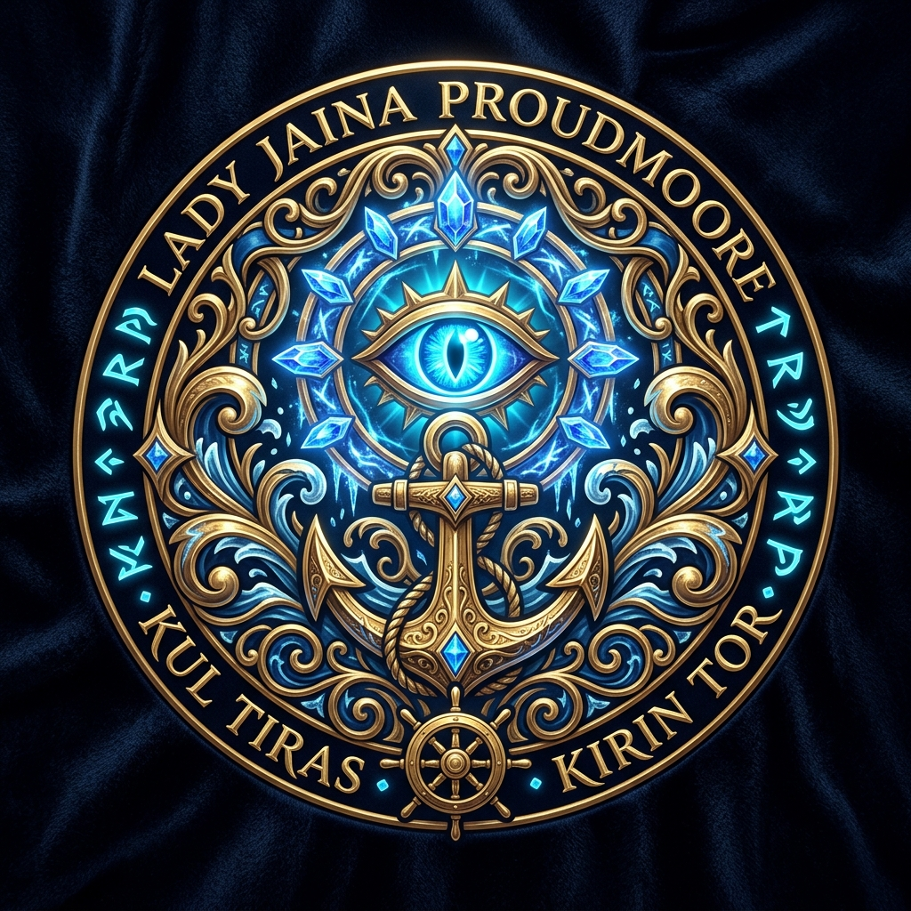

# 🌐 Project JAIna — Portal Web Oficial AAA (v7.1.0)

  
  <h1>Project JAIna — Portal Oficial</h1>
  
<strong>El portal web oficial de nueva generación para el reino de Theramore (WotLK 3.3.5a). Living Lore & AI Revolution.</strong>

  
<em>(La 'AI' destacada en <strong>Project JAIna</strong> es el guiño a la inteligencia artificial neuronal que da vida al ecosistema)</em>

  
<a href="https://darckrovert.github.io/ProjectJaina_Web/">🌐 Portal en Vivo: darckrovert.github.io/ProjectJaina_Web</a>

---

[-00ccff.svg)](./CHANGELOG.md)

[-blue.svg)](https://darckrovert.github.io/ProjectJaina_Web/)

---

## 🏛️ 1. Cuadro de Honor & Soberanía

| Rol | Miembro | Responsabilidad Principal |
| :--- | :--- | :--- |
| **👑 Creador, Director & Diseñador General** | **DarckRovert (Elnazzareno)** | Dirección de arte, visión estratégica, desarrollo de suites y arquitectura del reino. |
| **🧠 Staff Engineer de IA & Front-End L9** | **Antigravity (Mythos 5)** | Arquitectura de interfaz Glassmorphism arcano, puente REST API, optimización GPU y despliegue continuo. |

---

## 💎 2. Características del Portal AAA (v7.1.0)

* **Estética Arcana Premium:** Diseño Glassmorphism con paleta oficial de Theramore (Azul Arcano `#00ccff`, Oro Regio `#d4af37` y Abisal `#080b12`), animaciones aceleradas por GPU y sistema de diálogos no bloqueantes **Suite Kirin Tor** (cero `alert`/`confirm`/`prompt` nativos).
* **Living Lore & AI Revolution:** Sección interactiva que narra el despertar de los LoreBots, la arquitectura C++20 `JainaCore` (`jainacore.html`) y la integración del puente neuronal LLM.
* **Kirin Tor Arcane Sonic Studio (Fonoteca & Radio v7.1):**
  * **15 Canales Curados en 3 Suites:** *Lo-Fi & Estudio* (5 streams), *Sinfonías de Azeroth* (5 bandas sonoras orquestales de Theramore, Ventormenta, Orgrimmar, Dalaran y Corona de Hielo) y *Kirin Tor FM En Vivo* (5 señales radiales).
  * **Cross-Tab Sonic Mutex (`BroadcastChannel('pj_sonic_mutex')`):** Exclusión mutua acústica entre pestañas del navegador (Fonoteca global, `/radio/` dedicada y sondas de `/voz/`), preservando el *Auto-Ducking* al 18% durante sesiones de Voz Espacial 3D.
* **Topología Soberana Consolidada:**
  * **Reino 1 Oficial (Project Jaina):** Puerto `8085` (Servidor Principal, Anycast Zero-VPN L4 `ambulance-ergonomic.tun.ply.gg:11356`, DB: `acore_characters`). Alberga de forma unificada las modalidades de juego mediante el selector in-game (`80_GameModesSystem.lua`).
  * **Reino 3 (WanitosGym):** Puerto `8087` (Nodo de Cómputo y Laboratorio España / Standby).
* **Modos de Juego In-Game:** Normal Blizzlike con QoL, Hardcore Permadeath (con Santuario Anti-DC de 30s), Ironman Solitario, Die & Rise (metamorfosis necrótica de 3 vidas), Reto Andino x1 clásico y Herencia de Almas (+100% XP x2 tras perecer).
* **Arquitectura Económica & Divisas de Circuito Cerrado (Zero Pay-to-Win):**
  * **Ficha de Jaina (Item 900200):** WoW Token canónico canjeable por 100 PD o comerciable libremente por oro.
  * **Token de Jaina (Item 900100):** Divisa soberana 1:1 para cosméticos y monturas en tienda.
  * **Ficha de Evento (Item 910000):** Divisa cosmética para la Tienda Visual 3D (`/alas`) con 17 modelos de alas y auras.
  * **Onboarding Gratuito & AHBot Dynamic Buyer:** 5 Fichas gratuitas de minuto cero y agente comprador autónomo en Casa de Subastas (45s / 80% de probabilidad).
* **Bifacción Canónica Simétrica:** Una sola cuenta universal otorga acceso total al reino; la facción (**Alianza** u **Horda**) se elige libremente in-game con auto-incorporación a `<El Kirin Tor>` (Guild 21, Lady Jaina) o `<La Horda de Orgrimmar>` (Guild 22, Thrall).
* **Cronograma Interactivo de Progresión de Eras (2026–2028) & Chrono-Master v2.0:** Línea de tiempo visual de las 8 fases del reino (`Classic Vanilla` → `TBC` → `WotLK T7..T10.5` → `Cataclysm`) sincronizada en tiempo real con `/api/progression` y respaldo autónomo en `data/progression.json`.
* **Subpáginas Especializadas AAA:**
  * **Armería Soberana v7.1 (`armeria.html`):** 20 campeones con equipamiento canónico Tier 2 verificado (Paperdoll responsivo de 19 ranuras `"0".."18"`), barra de censo Alianza/Horda, filtros de facción/clase, ordenamiento por GS/Nivel/HKs y enlace compartible `?inspect=`.
  * **Base de Datos Soberana AoWoW v7.1 (`database.html`):** 72 registros verificados en 8 pestañas (Armas, Armaduras, Monturas, Criaturas, Misiones, Zonas, Pase de Batalla y los 6 Baluartes Soberanos), barra de filtros por rareza/orden e Inspector Soberano con guarda `< 900000` para ítems custom.
  * **Panel de Cuenta & Modo Sandbox (`cuenta.html`):** Gestión integral de cuenta SRP6, inventario de personajes, servicios in-game y **Modo Sandbox Interactivo** para previsualizar el panel cuando el backend local está desconectado.
  * **Tienda & Donaciones (`tienda.html`):** Catálogo visual de cosméticos, monturas y pases de batalla con tooltips limpios sin solapamiento e idempotencia transaccional.
  * **Registro SRP6 & Discord Quick-Bind (`registro.html`):** Alta segura con criptografía SRP6 RFC 5054, modal rápido de vinculación Discord con correo sintético válido RFC-5322 (`@discord.projectjaina.net`) y sonda de estado de AuthServer en vivo.
  * **Voz Espacial 3D (`voz/`):** Cliente web de audio binaural posicional HRTF con emparejamiento por PIN (`/voz`), selector dual-node (Perú y España), fallback de audio en 2 etapas y cifrado Multi-SAN SSL.
  * **BugTracker Comunitario (`bugs.html`):** Buscador en tiempo real, filtros por subsistema, cola local offline de reportes y asistente de copia rápida para Discord.
  * **Wiki & Compendio Oficial (`wiki/`):** Manual interactivo con buscador en vivo, contador de coincidencias, botones de copiado en bloques de código y dock de Fonoteca integrado.
  * **Descargas CDN & Espejos Oficiales:** Descarga en 1 clic del Lanzador Oficial Standalone **v2.1.3** (`ProjectJaina_Launcher_Oficial.zip`), espejos directos Google Drive y enlaces BitTorrent.

---

## 🚀 3. Despliegue en GitHub Pages y Enlaces Oficiales

El portal se sirve directamente a través de **GitHub Pages** (`main` & `gh-pages`):
* **URL Pública Oficial:** [https://darckrovert.github.io/ProjectJaina_Web/](https://darckrovert.github.io/ProjectJaina_Web/)
* **Comunidad Oficial Discord (Invitación Permanente):** [https://discord.gg/cXxMuRJrfy](https://discord.gg/cXxMuRJrfy)
* **Cliente de Voz Espacial 3D:** [https://darckrovert.github.io/ProjectJaina_Web/voz/](https://darckrovert.github.io/ProjectJaina_Web/voz/)
* **Radio Dedicada Kirin Tor FM:** [https://darckrovert.github.io/ProjectJaina_Web/radio/](https://darckrovert.github.io/ProjectJaina_Web/radio/)
* **Condiciones del Servicio:** [https://darckrovert.github.io/ProjectJaina_Web/terms.html](https://darckrovert.github.io/ProjectJaina_Web/terms.html)
* **Política de Privacidad:** [https://darckrovert.github.io/ProjectJaina_Web/privacy.html](https://darckrovert.github.io/ProjectJaina_Web/privacy.html)
* **Descarga del Lanzador Oficial v2.1.3 (.ZIP Directo):** [https://darckrovert.github.io/ProjectJaina_Web/downloads/ProjectJaina_Launcher_Oficial.zip](https://darckrovert.github.io/ProjectJaina_Web/downloads/ProjectJaina_Launcher_Oficial.zip)
* **Descarga del Lanzador Completo (.RAR Espejo Google Drive):** [https://drive.google.com/file/d/19emgLBtqUhxqf9SM_HM3PMYNqoaVG6WB/view?usp=drive_link](https://drive.google.com/file/d/19emgLBtqUhxqf9SM_HM3PMYNqoaVG6WB/view?usp=drive_link)
* **Descarga del Cliente Completo FHD (.RAR Espejo Google Drive):** [https://drive.google.com/file/d/1VlsfI9WvZ6kyaz03pwC3peJ_hSA3-2MZ/view?usp=drive_link](https://drive.google.com/file/d/1VlsfI9WvZ6kyaz03pwC3peJ_hSA3-2MZ/view?usp=drive_link)
